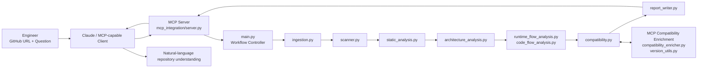

# Repository Analysis & Intelligence

A Python-based repository analysis solution that helps engineers
understand an existing GitHub repository without manually opening every
file first.

The solution scans the repository, extracts technical facts from the
code, builds architecture and code-flow information, analyzes
dependencies, and exposes the resulting repository intelligence to AI
clients such as Claude through Model Context Protocol (MCP).

> Core design principle: the AI client is not the primary source of
> repository facts. Python analysis modules inspect the repository; MCP
> exposes those capabilities and results; the AI client provides the
> conversational experience.

## What this project provides

Given a GitHub repository, the analysis workflow can identify
information such as:

-   repository structure and technologies
-   source, configuration, test and infrastructure artifacts
-   components, modules, imports and entry points
-   architecture and component relationships
-   runtime and detailed code flow where supported by the repository
-   APIs, integrations and external calls
-   dependencies and versions
-   current-version enrichment where reliable external information is
    available
-   higher-level repository summary and explanation

The analysis is repository-aware. Application repositories can receive
architecture/runtime/code-flow analysis, while infrastructure-oriented
repositories such as Terraform/EKS repositories are handled from an
infrastructure perspective instead of inventing an application flow.

## High-level architecture



A rendered diagram is also available at `docs/architecture.png`.

## End-to-end flow

1.  The engineer provides a GitHub repository and asks a repository
    question.
2.  Claude or another MCP-capable client invokes the configured MCP
    repository-analysis tool.
3.  `mcp_integration/server.py` exposes the repository-analysis
    capability.
4.  `main.py` controls the end-to-end analysis workflow.
5.  `ingestion.py` prepares the GitHub repository for processing.
6.  `scanner.py` inventories source code, dependency files,
    configuration, tests, infrastructure and other relevant artifacts.
7.  `static_analysis.py` derives repository facts and helps determine
    repository type/content.
8.  `architecture_analysis.py` derives components and relationships from
    code structure.
9.  `runtime_flow_analysis.py` and `code_flow_analysis.py` derive
    runtime and processing flow where applicable.
10. `compatibility.py` prepares detected dependencies and versions for
    compatibility/version enrichment.
11. MCP enrichment can add current external version information when it
    can be reliably obtained.
12. `report_writer.py` assembles the repository intelligence.
13. MCP makes the analysis available to the AI client, which presents it
    conversationally.

## Main modules

  ---------------------------------------------------------------------------------
  Module                                        Responsibility
  --------------------------------------------- -----------------------------------
  `main.py`                                     Main workflow controller

  `ingestion.py`                                Repository intake/preparation

  `scanner.py`                                  Repository inventory and file
                                                discovery

  `static_analysis.py`                          Technical facts and repository-type
                                                analysis

  `architecture_analysis.py`                    Components and architecture
                                                relationships

  `runtime_flow_analysis.py`                    Application runtime flow

  `code_flow_analysis.py`                       Detailed processing/code flow

  `compatibility.py`                            Dependency compatibility bridge

  `llm_analysis.py`                             Selective higher-level explanation

  `report_writer.py`                            Combines analysis results into
                                                final repository intelligence

  `models.py`                                   Shared data structures

  `config.py`                                   Shared configuration

  `mcp_integration/server.py`                   MCP server and repository-analysis
                                                tools

  `mcp_integration/client.py`                   MCP communication

  `mcp_integration/compatibility_enricher.py`   Current dependency/version
                                                enrichment

  `mcp_integration/version_utils.py`            Version normalization/comparison
  ---------------------------------------------------------------------------------

## Quick start

### 1. Clone the private repository

``` bash
git clone <PRIVATE_REPOSITORY_URL>
cd <REPOSITORY_DIRECTORY>
```

### 2. Create a Python virtual environment

macOS/Linux:

``` bash
python3 -m venv .venv
source .venv/bin/activate
```

Windows PowerShell:

``` powershell
python -m venv .venv
.venv\Scripts\Activate.ps1
```

### 3. Install project dependencies

If this repository contains `requirements.txt`:

``` bash
pip install -r requirements.txt
```

If the repository uses a different dependency mechanism, use the
dependency file already present in the project.

### 4. Configure environment variables

Create a local `.env` from the supplied example:

``` bash
cp .env.example .env
```

Set your own GitHub credential in `.env`.

``` dotenv
GITHUB_TOKEN=your_own_github_token
```

Never commit the real `.env` file or a real PAT/token.

### 5. Run the analysis

The source documentation identifies `main.py` as the workflow
controller. Use the invocation supported by the checked-in
implementation.

``` bash
python main.py
```

If `main.py` requires command-line arguments in the current
implementation, run:

``` bash
python main.py --help
```

and follow the options shown by the code. This README intentionally does
not invent arguments that are not verified in the source.

## Claude Desktop + MCP

The MCP server is implemented in:

``` text
mcp_integration/server.py
```

Claude Desktop must be configured to start/connect to that MCP server. A
typical local stdio configuration has this shape:

``` json
{
  "mcpServers": {
    "repository-analysis": {
      "command": "<ABSOLUTE_PATH_TO_PYTHON>",
      "args": [
        "<ABSOLUTE_PATH_TO_REPOSITORY>/mcp_integration/server.py"
      ]
    }
  }
}
```

Use the actual Python executable and repository path on your machine. If
the checked-in MCP server requires additional environment values,
configure them securely rather than placing secrets in this README.

After configuration:

1.  Restart Claude Desktop.
2.  Confirm the repository-analysis MCP tools are available.
3.  Ask Claude to analyze a repository that your GitHub credential is
    authorized to access.
4.  Claude invokes the MCP tool.
5.  MCP calls the Python repository-analysis workflow.
6.  The resulting repository intelligence is returned to Claude for
    conversational use.

Example prompt:

``` text
Analyze this GitHub repository: <REPOSITORY_URL>

Explain the repository structure, technologies, architecture, main components,
runtime/code flow, dependencies, APIs, tests, infrastructure and external
integrations. Base the explanation on the repository analysis and clearly mark
anything that cannot be reliably determined.
```

See `docs/mcp-claude-integration.md` for the complete flow.

## Cursor usage

Cursor can be used as the development environment for this repository.
Open the cloned project in Cursor, configure the same local environment
required by the Python implementation, and use the project documentation
to run/debug the analysis.

MCP configuration differs by client/version. When connecting Cursor
directly to this MCP server, configure Cursor to invoke
`mcp_integration/server.py` using the MCP configuration supported by the
installed Cursor version. Do not copy credentials into prompts or source
files.

See `docs/cursor-usage.md`.

## Security

-   Keep this repository private unless/until the owners intentionally
    approve publication.
-   Never commit GitHub PATs, API keys or other secrets.
-   Keep `.env` in `.gitignore`.
-   Commit only `.env.example` with placeholder values.
-   Give GitHub tokens only the permissions required for the
    repositories being analyzed.
-   If a real token was ever committed to Git history, revoke/rotate it;
    deleting it from the latest file is not sufficient.
-   Do not include secrets in screenshots, diagrams, logs or
    documentation.

## Documentation

-   [`docs/architecture.md`](docs/architecture.md) --- detailed
    architecture and module flow
-   [`docs/setup-and-run.md`](docs/setup-and-run.md) --- local setup and
    execution
-   [`docs/mcp-claude-integration.md`](docs/mcp-claude-integration.md)
    --- Claude Desktop/MCP integration
-   [`docs/cursor-usage.md`](docs/cursor-usage.md) --- using the project
    from Cursor
-   [`docs/troubleshooting.md`](docs/troubleshooting.md) --- common
    validation steps
-   [`docs/architecture.png`](docs/architecture.png) --- shareable
    architecture diagram

## Example engineer experience

``` text
Engineer
   |
   | GitHub URL + question
   v
Claude / MCP-capable client
   |
   | MCP tool call
   v
Repository Analysis MCP Server
   |
   | invokes
   v
Python Repository Analysis Engine
   |
   | repository-derived intelligence
   v
MCP
   |
   v
Claude
   |
   v
Simple, conversational repository explanation
```

## Current scope and extension points

The current design focuses on analyzing a repository and exposing that
intelligence through MCP. The same foundation can be extended into a
broader repository product experience, including project-level views
across multiple repositories, richer GitHub metadata, branch/version
comparison, contributor information and visual repository relationships.
Those items should be treated as extension points unless they are
present in the checked-in implementation.

## Maintainer note

Before sharing this repository with another engineer, validate the setup
from a clean clone and confirm that:

-   dependencies install successfully
-   no secrets are committed
-   the documented entry point works
-   the MCP server starts
-   the AI client can see the MCP tools
-   a test repository can be analyzed end-to-end
